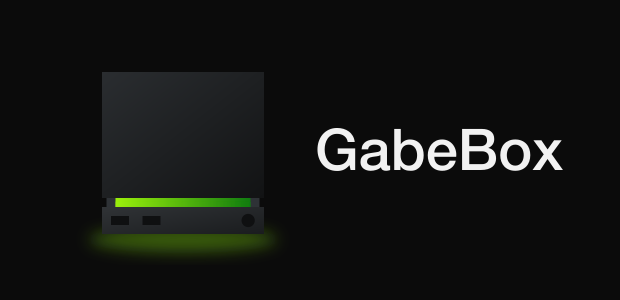

# GabeBox

<p align="center"></p>

**Turn your Xbox into a GabeCube.**

GabeBox aims to bring Valve’s SteamOS experience to Xbox Series X and Series S. Sign in with Steam Guard to play your own Steam library. GabeBox adapts desktop windowing, graphics, and controller input so supported games can run locally on the Xbox.

Compatibility is experimental and depends on the game’s Steam build and the runtime packaged for it. The results below are from Series X testing. Series S verification is still open.

[Requirements](#requirements) · [Releases](#releases) · [What works](#what-works) · [Setup](#setup) · [Build from source](#build-from-source) · [Open issues](#open-issues)

## Requirements

- **Xbox Series X or Series S** in Developer Mode with Device Portal enabled and an Xbox profile signed in. [Activate Developer Mode](https://learn.microsoft.com/en-us/previous-versions/windows/uwp/xbox-apps/devkit-activation)
- **Steam account** that owns the games you want to play, with Steam Guard in the Steam Mobile app to approve the QR sign-in.
- **Internet access and free space** on the Xbox for Steam sign-in and game downloads. [Provision Xbox development storage](#provision-xbox-development-storage)
- **Deployment computer** that can reach the Xbox’s HTTPS Device Portal, with Python 3.9 or newer and a checkout of this repository for the deployment CLI.
- **Signed GabeBox APPX** with its matching publisher certificate and any x64 framework packages required by that build. [Build from source](#build-from-source)

## Releases

The locally signed Steam APPX uses Valve’s pinned files and is assembled separately. Later development builds and title trials are recorded in the hardware notes. [All releases](https://github.com/clankur/GabeBox/releases) · [Series X test ledger](analysis/big-picture-reliability.md)

## What works

Development packages built from `main` (the `1.0.232` series) were tested on Series X OS `26100.9673`:

- **Sign-in and startup.** Cached sign-in reaches a controller-ready Big Picture Library in a median of 14.8 seconds. [Startup measurements](analysis/steam-ui-cached-login-startup.md)
- **Install, Downloads, and storage.** Big Picture’s **Install** button feeds the authenticated Steam download queue, and the detail page switches to **Play** when the download finishes. The stock Downloads and Storage pages show the queue and the `D:` Xbox Development Storage library with its free space. USB drives can also hold a Steam library. [Downloads and storage evidence](analysis/steam-ui-downloads-storage.md#console-acceptance)
- **Steam Cloud saves.** The stock **Manage → Cloud backups** menu creates backups and restores them.
- **Game presentation and input.** Hosted games present through a shared native 1920 × 1080 renderer using shared GPU textures. The SDL, XInput, and presenter paths share one hosted controller packet. [Native fullscreen presentation](docs/GAME-LAUNCH.md#native-fullscreen-presentation)
- **Store recovery.** A Store request that stalls now times out, clears the loading state, and returns to the Library. [Store investigation](analysis/steam-ui-store.md#latest-series-x-check)

| Game | Observed on Xbox Series X |
| --- | --- |
| **Slay the Spire** | On `1.0.232.13`, stock **Play** continued a Cloud-restored run to floor 34. The settled room averaged 59.90 FPS at 1920 × 1080 over 30 seconds using shared GPU textures. Combat and audio still need a recheck on the current build. [Current-build results](analysis/steam-ui-cloud-performance.md#xbox-acceptance) |
| **Stardew Valley** | Earlier builds reached the title menu from Big Picture and averaged 59.97 FPS at 1920 × 1080 during outdoor farm movement using shared GPU textures. It has not been rechecked on a `1.0.232` package. [Launch ledger](analysis/big-picture-reliability.md#game-launches-and-returns) · [Gameplay measurement](docs/GAME-LAUNCH.md#native-fullscreen-presentation) |
| **Hades** | The x64 DirectX build supports controller gameplay with its build-matched profile. A 30-second 1080p shared-GPU sample on `1.0.230.106` averaged 56.03 FPS with visible hitches. It has not been rechecked since the runtime reorganization. [Hades profile and results](analysis/hades-compatibility.md) |
| **Marvel’s Spider-Man Remastered** | On `1.0.232.15`, Big Picture **Play** entered the Clearing the Way world and responded to right-stick camera input. The 30-second world sample averaged 51.23 FPS at 1920 × 1080 output. Surfaces are missing and the player character is not clearly visible. [Spider-Man trial](analysis/spider-man-compatibility.md#world-entry-recovery-after-the-runtime-restructure) |

## Setup

### Provision Xbox development storage

`D:` is the Xbox’s internal Developer Mode storage. In current GabeBox builds it appears as **Xbox Development Storage** in Big Picture, and GabeBox creates `D:\DevelopmentFiles\SteamLibrary` when it opens that library. This support landed after the `1.0.230.37` tag. [Build from source](#build-from-source)

**Back up existing Dev Mode data before resizing.** Changing the allocation can erase sideloaded apps, installed games, and saves stored on the developer partition. If the current allocation has enough space, keep it. [Dev storage guide](https://yosonia.com/en/510)

1. In **Dev Home** on the Xbox, press the controller’s **Menu** button and choose **Manage Dev Storage**.
2. Set an allocation large enough for the games you want to install and Steam’s temporary download and unpacking files. Select **Save** and follow the console’s restart prompts. [Dev Mode setup guide](https://github.com/XboxEmulationHub/devmodewiki/blob/master/docs/xbox-setup/xbox-developer-mode-setup.mdx#configuration)
3. After deploying GabeBox and signing in, open Big Picture **Settings → Storage**. Confirm **Xbox Development Storage** is available and has enough free space. Select it as the default install location if another drive is selected.

### Deploy and sign in

Run the commands from the repository root. Use `python3 -m tools.xbox_deploy --help` to list the [Device Portal CLI](tools/xbox_deploy.py) commands.

1. Set `XBOX_PORTAL_URL` to the HTTPS address shown in Dev Home, usually `https://<xbox-ip>:11443`. [Microsoft’s Xbox Device Portal example](https://learn.microsoft.com/en-us/microsoft-edge/webview2/how-to/remote-debugging-xbox#attach-devtools-remotely-to-an-xbox-webview2-winui-2-uwp-app)
2. Run `python3 -m tools.xbox_deploy fingerprint`. Compare the SHA-256 fingerprint with the Portal certificate, then set `XBOX_PORTAL_CERT_SHA256` to the verified fingerprint.
3. If your Portal uses authentication, set `XBOX_PORTAL_USERNAME`. The CLI prompts for the password unless you supply `XBOX_PORTAL_PASSWORD`. For a Portal that accepts unauthenticated connections, leave both credential variables unset.
4. Deploy the signed APPX with its matching certificate. Open the installed app in Dev Home, approve the QR code with Steam Guard, and select **Install** or **Play** in your library.

```sh
python3 -m tools.xbox_deploy deploy ./gabe-signed/PackagedProcessProbe-x64.appx \
  --certificate ./gabe-signed/PackagedProcessProbe.cer
```

If the package requires Visual C++ UWP or UWP Desktop frameworks, pass each matching x64 APPX with a separate `--dependency` argument. The standalone [process probe](probe/README.md) can verify Dev Mode deployment before you assemble the Steam package.

## Build from source

The GitHub Actions workflows compile the x64 native components with the Windows SDK. Local assembly uses **Python 3.9+**, **Bash**, **`makemsix`**, **OpenSSL**, **`osslsigncode`**, and **`shasum`**. Use fresh output directories.

### 1. Collect the build inputs

| Input | Where it comes from |
| --- | --- |
| Verified Steam Core FHD base APPX | The integrated builder accepts the exact regular `1.0.230.0` package or its signed `1.0.231.0` recovery package. Compare the file hash with the [accepted base pins](build_tools/prepare_big_picture_library.py). |
| `xbox-steam-core-template` | Checksum-pinned source for the native Steam DLL, WinRT metadata, and Win32 adapters required by the selected profiles. [Build Xbox probe](https://github.com/clankur/GabeBox/actions/workflows/xbox-probe.yml) |
| `xbox-big-picture-webview-x64` | Big Picture WebView2 host. [WebView2 host workflow](https://github.com/clankur/GabeBox/actions/workflows/xbox-big-picture-webview.yml) |
| `xbox-big-picture-primary-x64` and `xbox-fhd-present-x64` | Primary XAML window and native game presenter for the single-window build. [Primary host workflow](https://github.com/clankur/GabeBox/actions/workflows/xbox-big-picture-primary.yml) · [Presenter workflow](https://github.com/clankur/GabeBox/actions/workflows/xbox-fhd-present.yml) |
| Title-specific runtimes and profiles | Match the game’s installed Steam build. The [SDL workflow](https://github.com/clankur/GabeBox/actions/workflows/xbox-sdl.yml) publishes versioned SDL builds. The [game launch guide](docs/GAME-LAUNCH.md) lists per-title inputs. |

Use workflow artifacts from the same source revision where possible and verify their `SHA256SUMS`. The base APPX is a separate input from the release source archive and the Steam Core CI template. If you’re starting without the pinned base, you can build the [packaged process probe](probe/DEVELOPMENT.md) or assemble the [Steam Core prototype](docs/STEAM-CORE.md#run-the-on-console-sign-in) using the CI template.

### 2. Assemble and sign

Set `FHD_BASE` to the verified base APPX and `WEBVIEW`, `SESSION`, `PRIMARY`, and `PRESENTER` to the extracted artifact directories. Set the three `*_PIN` variables to the independently recorded SHA-256 digests of their respective `SHA256SUMS` files. Set `PACKAGE_VERSION` to a four-part version higher than the base and the installed build under the same package identity.

```sh
python3 -m build_tools.prepare_big_picture_library \
  "$FHD_BASE" "$WEBVIEW" ./gabe-layout --version "$PACKAGE_VERSION" \
  --session-artifact "$SESSION" --session-checksum "$SESSION_PIN" \
  --primary-xaml "$PRIMARY" --primary-checksum "$PRIMARY_PIN" \
  --presenter-artifact "$PRESENTER" --presenter-checksum "$PRESENTER_PIN"

bash build_tools/package.sh --layout ./gabe-layout ./gabe-signed
(cd ./gabe-signed && shasum -a 256 -c SHA256SUMS)
```

The builder verifies Valve’s [pinned client manifest](runtime/steam/pins/steam_client_win64.manifest) and the archive bytes it stages. Pass `--archive-cache /path/to/cache` to use a local copy. Add the title’s runtime flags before signing. For exact input hashes and examples, see the [single-window build recipe](analysis/big-picture.md#reproduce-the-single-window-series-x-build) and the [Hades build-matched profile](analysis/hades-compatibility.md#prepare-the-build-matched-profile).

## Open issues

| Area | What’s still open |
| --- | --- |
| **Windows game compatibility** | Spider-Man needs complete world rendering and verified movement. Factorio, Unity titles, and the DOS runtime for X-COM still need work on `main`. 32-bit x86 titles such as Terraria need a shared 32-bit runtime. [Compatibility investigations](analysis/steam-compatibility.md) · [Spider-Man #67](https://github.com/clankur/GabeBox/issues/67) · [Factorio #43](https://github.com/clankur/GabeBox/issues/43) · [Terraria #34](https://github.com/clankur/GabeBox/issues/34) · [X-COM #44](https://github.com/clankur/GabeBox/issues/44) |
| **Performance** | Hades (56.03 FPS with hitches) and Spider-Man (51.23 FPS) miss sustained 60 FPS at native 1080p. Slay the Spire and Stardew Valley need gameplay samples on the current build. [Cloud and performance analysis](analysis/steam-ui-cloud-performance.md) · [Hades results](analysis/hades-compatibility.md) |
| **Store** | Store requests reach the WebView2 controller but time out without a navigation start. Loaded storefront content and product navigation are still unconfirmed. [Store investigation](analysis/steam-ui-store.md) |
| **Overlay and Steam Input** | The physical-controller Play → overlay → Resume → Exit cycle is unverified on the current build. Controller settings show no connected controllers, and Steam-owned remapping is untested. [Overlay and input review](analysis/steam-ui-overlay-input.md) · [Steam Input design](analysis/steam-input.md) |
| **Downloads and storage** | Cold shared-prerequisite recovery and competing download transitions need an isolated library on Xbox. Pause and queue reordering are unsupported. [Queue and path analysis](analysis/steam-ui-downloads-storage.md) · [Game paths #54](https://github.com/clankur/GabeBox/issues/54) · [Download queue #55](https://github.com/clankur/GabeBox/issues/55) |
| **Saves** | Cloud backup and restore are verified only for Slay the Spire. Other titles need save and reload checks through Big Picture **Play**. [Steam Cloud #56](https://github.com/clankur/GabeBox/issues/56) |
| **Mouse input** | A Dev Mode package cannot read a physical Xbox mouse. Presenting the mouse as a controller through an Xbox Adaptive Controller adapter awaits hardware testing. [Mouse input finding](analysis/xbox-mouse-input.md) · [mouse2xac #83](https://github.com/clankur/GabeBox/issues/83) |
| **Series S** | No results yet. |

[Browse all open issues](https://github.com/clankur/GabeBox/issues?q=is%3Aissue+is%3Aopen)

## Development

GabeBox follows Proton’s component-based structure. `runtime/` contains the reusable Steam host, Win32 adapters, SDL integration, and native presenter. `profiles/` selects compatibility behavior for specific Steam builds. `ui/` contains sign-in and Big Picture, `build_tools/` assembles packages, `probe/` checks individual capabilities on Xbox, and `tools/` handles deployment and runtime observation. [Proton source tree](https://github.com/ValveSoftware/Proton/tree/1f089f5610a882c8bfcb4b58a3c86ee88bb4b9f1) · [Probe catalog](probe/README.md) · [Contributor guidance](AGENTS.md)

Use uv to run the same locked Python lint and test tools as CI. [Install uv](https://docs.astral.sh/uv/getting-started/installation/)

```sh
uv run --locked ruff check
uv run --locked python -m pytest
node --test tests/*.test.js tests/big-picture-webview/*.test.js
```

The Python commands under Setup and Build use only the standard library. You can also run the Python tests with `python3 -m unittest discover -s tests`.

When reporting a game issue, include the Steam AppID and build, GabeBox package version, Xbox model and OS build, and the first visible or logged failure. The [diagnostic guide](docs/XBOX-DIAGNOSTICS.md) covers launch, input, render, and frame traces. The [research archive](analysis/steam-client-audit.md) records how the original Steam client was inspected and adapted.

The standalone [Steam client emulation experiment](analysis/leaf-test/REPORT.md#reproduction) uses uv with its own dependency lockfile.
